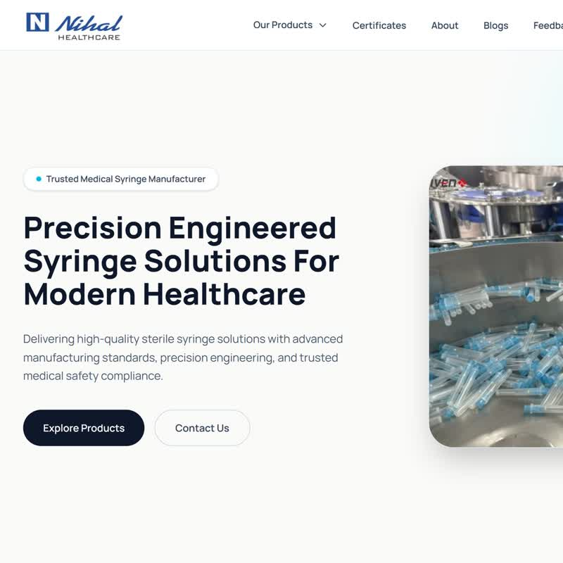
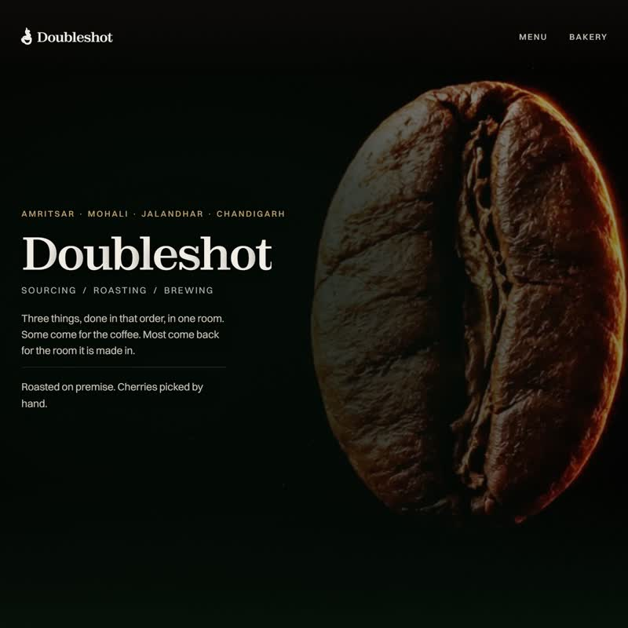
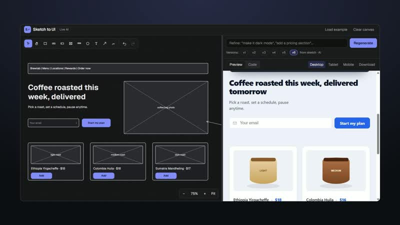
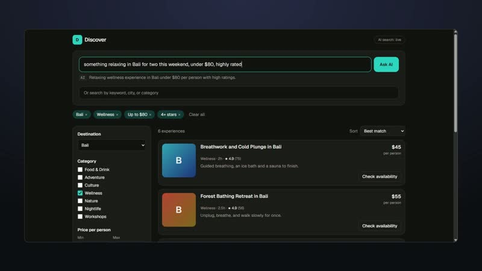

# Shivam Dawar

**AI strategist and builder.** I find where a small business loses time or money, then build the website, dashboard or AI tool that fixes it.

[Orvyn Solutions](https://orvynwebsite.vercel.app) · [Email](mailto:shivamdawar0031@gmail.com) · [WhatsApp](https://wa.me/919355170131)

Showreel preview. Full films on the <a href="https://orvynwebsite.vercel.app">studio site</a>.

## What I build

- **Websites** that turn visitors into enquiries
- **Live dashboards** that show a business owner what is selling and what is running out
- **AI tools and chatbots** for repetitive work
- **Short brand and ad films**

## Selected work

<table>
  <tr>
    <td width="50%" valign="top">
      
       <b>Nihal Healthcare</b> 
      A live, mobile-ready product catalogue with 23+ variant pages and a direct enquiry route on each.
       <a href="https://nihalhealthcare.com/">nihalhealthcare.com</a>
    </td>
    <td width="50%" valign="top">
      
       <b>Doubleshot Coffee Roasters</b> 
      A one-page site for a Punjab roastery and eggless bakery: sourcing, roasting and brewing told as one scroll.
       <a href="https://doubleshotcoffeeroasters.vercel.app/">doubleshotcoffeeroasters.vercel.app</a>
    </td>
  </tr>
  <tr>
    <td width="50%" valign="top">
      
       <b>Sketch to UI</b> 
      Draw a rough layout in the browser and AI turns it into an interactive page you can refine in plain English.
       <a href="https://sketch-to-ui.vercel.app/">sketch-to-ui.vercel.app</a>
    </td>
    <td width="50%" valign="top">
      
       <b>Discover</b> 
      A travel experiences marketplace where you describe what you want in your own words and AI turns it into precise search filters.
       <a href="https://ai-experience-search.vercel.app/">ai-experience-search.vercel.app</a>
    </td>
  </tr>
</table>

## Open source projects

- **[Coffee Shop CRM](https://github.com/legend12-rgb/coffee-shop-crm-dashboard)**: a real-time sales and inventory dashboard. Every sale appears the moment it is recorded, and a database trigger keeps stock, alerts and the inventory ledger in sync. Next.js, TypeScript, Supabase and Postgres.
- **[Orvyn studio website](https://github.com/legend12-rgb/orvyn-studio-website)**: the source of my studio site. Next.js, TypeScript and GSAP, built mobile first.

## Tools I work with

## Work with me

If your business loses time on enquiries, bookings, stock or follow-ups, message me on [WhatsApp](https://wa.me/919355170131) or email [shivamdawar0031@gmail.com](mailto:shivamdawar0031@gmail.com). I reply with what I would fix first.
